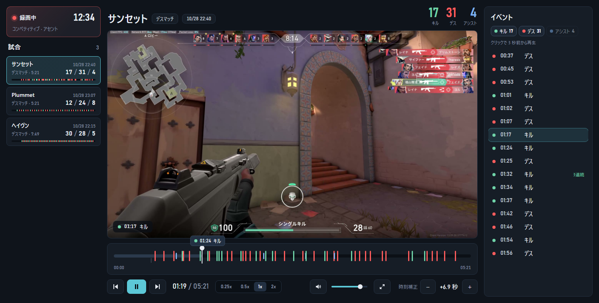

# ValoCapture

VALORANT の試合を自動で録画し、キル・デス・アシストなどのイベントから見返せる Windows 用アプリです。

- **自動で録画**：タスクトレイに常駐し、試合が始まると録画を開始、終わると停止します。操作は不要です
- **イベントから見返す**：試合後にキル・デス・アシストが録画のタイムラインに並び、クリックするとその場面から再生できます
- **容量を気にせず使える**：上限を決めておくと古い試合から自動で削除します。☆ブックマークした試合は残ります

## 動作環境

- Windows 10 / 11（64 ビット）
- VALORANT（Riot クライアントからサインインして使う通常の環境）

## はじめかた

1. 配布用の `ValoCapture-<バージョン>.zip` を、デスクトップやドキュメントなど好きなフォルダに展開します
   - zip を開いたまま中の exe を起動しないでください
2. `ValoCapture.exe` をダブルクリックして起動します。インストールや管理者権限は不要です
3. タスクトレイ（画面右下）にアイコンが出たら準備完了です。あとは VALORANT で試合をするだけで録画されます。録画中はアイコンが赤い丸に変わります

初回起動時に「Windows によって PC が保護されました」と表示されたら、「詳細情報」→「実行」で起動できます（コード署名をしていない個人制作のアプリのため表示されます）。

## 使い方

### 録画するモードを選ぶ

初期設定ではコンペティティブだけを録画します。タスクトレイのアイコンを右クリックし、「録画するモード」から録画したいモードにチェックを入れてください。

選べるモード：コンペティティブ、アンレート、スイフトプレイ、スパイクラッシュ、デスマッチ、チームデスマッチ、プレミア

### 試合を見返す

タスクトレイのアイコンを右クリックして「録画を見る」を選ぶと、録画の一覧が開きます。

- 左の一覧から試合を選ぶと再生できます。☆を付けた試合は容量制限で削除されません
- イベント（キル・デス・アシスト・ラウンドの開始）は試合が終わってから追加されます。クリックするとその 3 秒前から再生します
- 再生速度は 0.25x / 0.5x / 1x / 2x から選べます
- 動画ファイルそのものは、右クリックメニューの「録画フォルダを開く」から開けます

### 再生中のキー操作

| キー | 操作 |
| --- | --- |
| Space | 再生 / 一時停止 |
| ← / → | 5 秒戻る / 進む |
| , / . | 0.1 秒戻る / 進む（コマ送り） |
| P / N | 前 / 次のイベントへ |
| ↑ / ↓ | 音量を上げる / 下げる |
| M | ミュート |
| F | 全画面（Esc で戻る） |

### イベントの位置が動画とずれているとき

ビューアの「時刻補正」の − / ＋ で、イベントの位置を 0.1 秒ずつ前後に調整できます。

## 設定

タスクトレイのアイコンを右クリックして「設定…」を選ぶと、次の項目を変更できます。

| 項目 | 内容 |
| --- | --- |
| 起動 | Windows の起動時に自動で起動する |
| 録画の音声 | ゲーム音を録音する出力デバイス、マイクの音を録画に含めるかどうかとそのデバイス |
| 保存 | 動画の保存先、動画の容量の上限（GB） |

保存先を変えると、次の試合から新しい場所に録画します。それまでの録画は移動しません。

## 保存場所と容量

| 保存するもの | 場所 |
| --- | --- |
| 録画 | `ビデオ\ValoCapture`（設定で変更できます） |
| 設定 | `%APPDATA%\ValoCapture` |

録画は 1080p・60fps で、1 試合あたり数 GB になります。ディスクがいっぱいにならないよう、設定の「動画の容量を制限する」で上限を決めておくのがおすすめです。上限を超えると古い試合から削除します（☆ブックマークした試合は残ります）。

## 困ったとき

| 症状 | 対処 |
| --- | --- |
| 起動しない・録画が始まらない | [Visual C++ 再頒布可能パッケージ（x64）](https://aka.ms/vs/17/release/vc_redist.x64.exe) をインストールしてください |
| 試合をしても録画されない | そのモードが「録画するモード」に入っているか確認してください（初期設定はコンペティティブのみ） |
| 「すでに起動しています」と出る | タスクトレイ（隠れているアイコンの中も）を確認してください |
| イベントが表示されない | 試合が終わってから追加されます。しばらく待っても出ないときはビューアの再読み込みを試してください |

## アンインストール

タスクトレイのアイコンを右クリックして「終了」したあと、`ValoCapture.exe` を削除してください。録画や設定も消したいときは、上の「保存場所」の 2 つのフォルダも削除します。

## 注意

- Riot Games 非公式のツールです。試合情報の取得に Riot クライアントのローカル API と非公式 API を読み取り専用で使っています。ゲームへの書き込みや注入は一切しません
- 自己責任でお使いください

## 開発者の方へ

ビルド方法やプロジェクト構成は [docs/development.md](docs/development.md) を参照してください。
